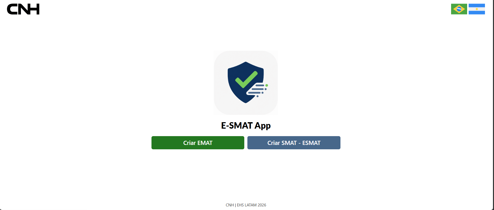
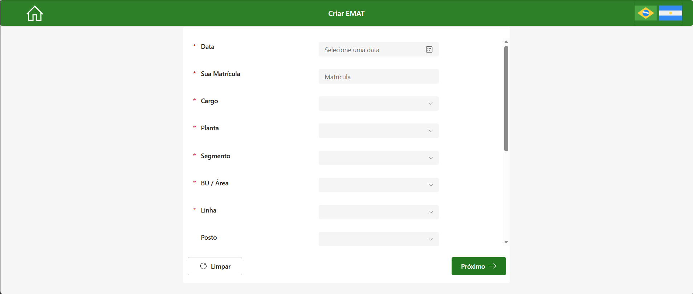
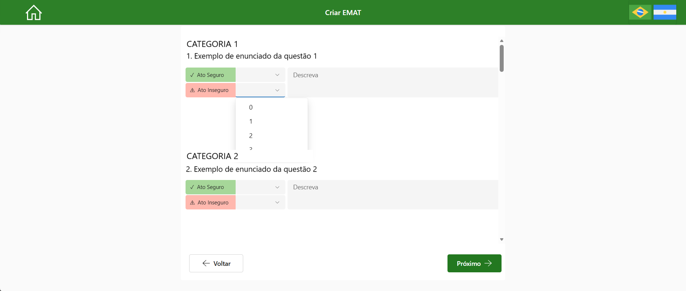
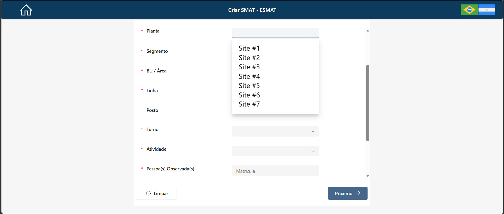
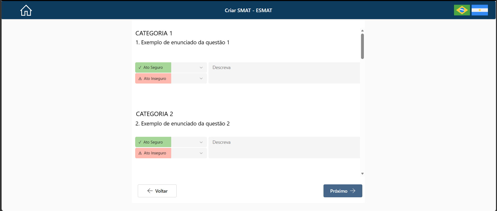
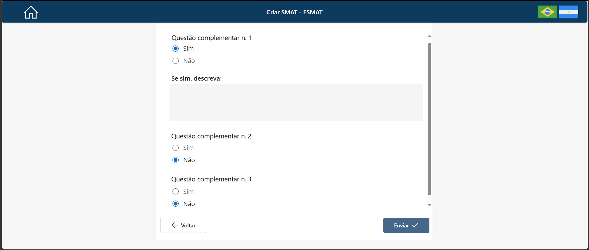
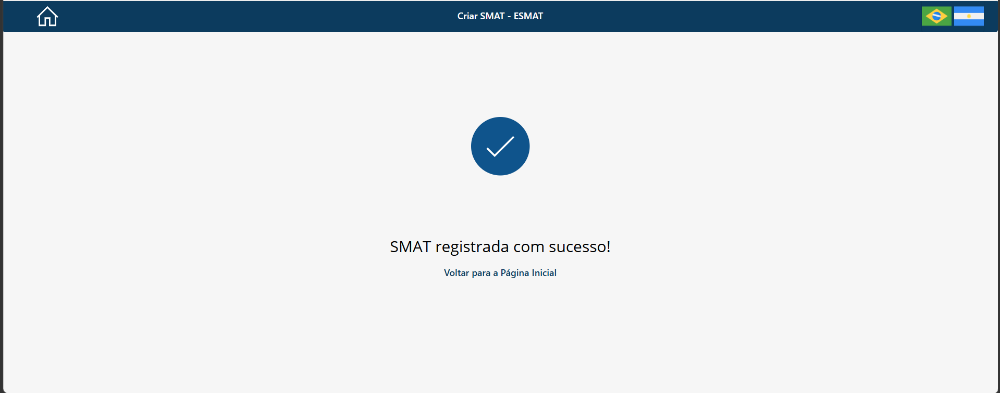

# E-SMAT Application Overview

## Overview

E-SMAT is a bilingual Microsoft Power Apps application developed to standardize the registration of safety and environmental inspections across six operational sites in Brazil and Argentina.

The application supports three inspection methodologies:

- **EMAT — Environment Management Audit Training**
- **SMAT — Safety Management Audit Training**
- **ESMAT — Integrated Environment and Safety Management Audit Training**

E-SMAT combines a shared application structure with site-specific configurations. Based on the selected workflow, operational location, applicable methodology, active questionnaire version, and interface language, the application dynamically presents the appropriate inspection experience.

SharePoint Lists provide the reference and operational data used by the application, including location hierarchies, inspection requirements, question categories, bilingual interface content, inspection headers, and question-level responses.

> This repository presents an anonymized portfolio representation of the application. All visible fields, identifiers, operational references, records, and screenshots were anonymized before publication.

---

## Business Context

The participating operational sites have different safety and environmental requirements, location structures, inspection methodologies, questionnaires, and language needs.

Creating a separate application for each site would duplicate screens and business logic, increase maintenance effort, and make process standardization more difficult.

E-SMAT was therefore developed as a single configurable application capable of:

- Standardizing inspection registration across multiple sites;
- Supporting safety, environmental, and integrated inspections;
- Adapting questionnaires to each operational context;
- Supporting users in Brazil and Argentina;
- Guiding users through valid location hierarchies;
- Preserving entered information during navigation within the active session;
- Centralizing finalized inspection records in SharePoint.

---

## Operational Scope

E-SMAT supports six operational sites in Brazil and Argentina.

Each site uses a specific inspection form according to its operational characteristics and predefined business requirements. The application supports:

- Site-specific questionnaires;
- Different operational location hierarchies;
- EMAT, SMAT, and ESMAT methodologies;
- Brazilian Portuguese and Argentine Spanish;
- Dynamic requirement loading;
- In-session state persistence;
- Final inspection submission;
- SharePoint-based reference and operational storage.

The public repository uses anonymized screenshots and generalized descriptions instead of real site mappings, internal location structures, or proprietary inspection requirements.

---

## Application Preview

### Shared Home Screen



The home screen is the shared entry point for the application. It provides separate access to the EMAT and SMAT / ESMAT workflows.

The interface is automatically initialized in Brazilian Portuguese or Argentine Spanish according to the language configured on the user's device or browser. The flag controls allow the user to change the active language manually.

---

## Inspection Methodologies

### EMAT

**Environment Management Audit Training**

EMAT is the environmental inspection workflow within E-SMAT.

The workflow has a dedicated entry point on the home screen and dynamically loads the environmental requirements associated with the selected site and inspected location.

The EMAT interface uses green as its primary visual color, visually differentiating the environmental workflow from the safety and integrated workflows.

For each applicable requirement, the user can register quantities associated with safe and unsafe observations and add a description when necessary.

#### EMAT Identification



The identification screen collects the inspection context and guides the user through the configured operational hierarchy.

#### EMAT Questionnaire



The environmental questionnaire is dynamically populated from SharePoint reference data. The displayed content depends on the selected operational context, applicable version, active status, category, and display order.

### SMAT

**Safety Management Audit Training**

SMAT is focused on occupational safety inspections and the registration of safe and unsafe observations.

SMAT shares its initial entry point with ESMAT. The user does not manually choose between the two methodologies on the home screen. The applicable questionnaire is determined after the inspection context and operational location are identified.

### ESMAT

**Integrated Environment and Safety Management Audit Training**

ESMAT combines safety and environmental requirements in a single inspection workflow.

The methodology is used only by sites with the corresponding configuration. E-SMAT determines whether the applicable questionnaire is SMAT or ESMAT according to the selected site, location hierarchy, and configured business rules.

SMAT and ESMAT use blue as the primary visual color of the workflow.

#### SMAT / ESMAT Identification



Both methodologies share the same identification screen. After validation, the application evaluates the operational context and routes the user to the applicable questionnaire.

#### Dynamic SMAT / ESMAT Questionnaire



The questionnaire displays only the requirements associated with the applicable site, methodology, version, category, and active status.

---

## Application Entry Points

The home screen provides two inspection options:

- **Create EMAT**
- **Create SMAT / ESMAT**

The EMAT option starts a dedicated environmental inspection workflow.

The SMAT / ESMAT option starts a shared workflow. After the user identifies the inspected location, the application evaluates the corresponding configuration and loads the applicable SMAT or ESMAT questionnaire.

This approach reduces unnecessary user decisions and helps prevent the selection of a questionnaire that is incompatible with the inspection context.

---

## Main Features

### Automatic Language Detection

When E-SMAT starts, the application identifies the language configured on the user's device or browser and automatically loads the corresponding interface:

- Brazilian Portuguese (`pt-BR`);
- Argentine Spanish (`es-AR`).

Language controls remain available in the application header, allowing the user to switch between Portuguese and Spanish when necessary.

Detailed localization behavior is documented in [`localization.md`](localization.md).

### Inspection Identification

Before loading a questionnaire, the application collects the information required to identify the inspection and its operational context.

The identification step includes fields associated with:

- Inspection date;
- Observer identifier;
- Observed-person identifiers;
- Position or job role;
- Shift;
- Activity type;
- Contract type;
- Site;
- Segment;
- Business unit or area;
- Line;
- Workstation.

Required fields are visually identified, and the application validates the necessary information before allowing the user to proceed.

### Cascading Location Filters

The inspected location is selected through a cascading hierarchy:

```text
Site
  ↓
Segment
  ↓
Business Unit / Area
  ↓
Line
  ↓
Workstation
```

Each selection filters the options available in the next field. When an upstream value changes, the dependent selections are reset or reevaluated.

This mechanism prevents invalid location combinations and ensures that the inspection is associated with a configured operational structure.

The detailed filter logic is documented in [`cascade-filtering.md`](cascade-filtering.md).

### Dynamic Questionnaire Loading

After the inspection context is identified, E-SMAT evaluates the applicable configuration and dynamically loads the corresponding questionnaire.

Question selection may consider:

- Selected workflow;
- Operational site;
- Inspected location;
- Applicable methodology;
- Questionnaire version;
- Safety or environmental theme;
- Question category;
- Active or inactive status;
- Display order;
- Active interface language.

Inspection requirements are maintained in SharePoint reference lists rather than individually hard-coded into the application screens.

### Safe and Unsafe Observation Registration

The questionnaire allows users to register safe and unsafe observations for each applicable requirement.

The interface uses visual differentiation:

- Green for safe observations;
- Red for unsafe observations.

Users can also provide descriptive information about the observed condition or practice.

In the EMAT workflow, numeric selectors allow quantities of safe and unsafe observations to be associated with each environmental requirement.

### Complementary Questions

After completing the main questionnaire, the application presents a final set of complementary questions.

This stage records information such as:

- Whether an unsafe condition was identified;
- A description of the unsafe condition, when applicable;
- Whether a safety tag was opened;
- The associated tag number, when applicable;
- Whether a near miss was identified;
- A description of the near miss, when applicable.

#### Complementary Questions Screen



The same functional stage is used to complete the inspection before the final submission.

### In-Session State Persistence

E-SMAT preserves the inspection context and entered information while the user navigates between screens during the active application session.

After the identification data is validated, the application stores the inspection context in Power Apps variables. The questionnaire responses remain available while the user moves forward or backward within the active inspection flow.

This behavior is not a user-accessible draft feature:

- The user cannot close the application and later reopen a saved draft;
- The user cannot retrieve a submitted inspection for editing;
- The app does not provide a post-submission editing workflow.

The detailed behavior is documented in [`state-persistence.md`](state-persistence.md).

### Final Submission

The final submission process uses a header-detail structure.

First, E-SMAT creates or updates the inspection header containing the shared inspection information. After the header is confirmed, the application processes the questionnaire gallery and creates one response record for each question.

A shared inspection identifier relates the header to the question-level records.

Before storage, selected bilingual values are normalized to consistent analytical values. Examples include shift, activity type, contract type, position, and Yes / No responses.

### Submission Confirmation

After the submission sequence is processed, E-SMAT displays a methodology-specific confirmation screen.



The confirmation screen contains:

- A visual success indicator;
- A registration message reflecting the submitted methodology;
- An action to return to the home screen;
- Portuguese and Spanish language controls.

The confirmation completes the current inspection flow. The submitted record is not made available to the inspection user for later editing within the application.

---

## SharePoint-Based Configuration

E-SMAT uses structured SharePoint Lists as its reference and operational data layer.

The application consumes reference data related to:

- Operational location hierarchy;
- Inspection requirements;
- Question categories;
- Questionnaire methodology and version;
- Active and inactive questions;
- Portuguese and Spanish interface content.

Finalized inspection data is stored using two related structures:

- An inspection header with the shared contextual information;
- Question-level records containing the answers associated with the inspection.

This configuration-driven approach separates application behavior from business content and supports centralized maintenance without requiring a separate application for every site.

---

## High-Level Application Flow

```text
Open E-SMAT
      ↓
Detect Device or Browser Language
      ↓
Load Portuguese or Spanish Interface
      ↓
Allow Manual Language Switching
      ↓
Select Inspection Workflow
      │
      ├── Create EMAT
      │        ↓
      │   Identify Inspection and Location
      │        ↓
      │   Apply Cascading Location Filters
      │        ↓
      │   Validate Required Information
      │        ↓
      │   Preserve Context in Session Variables
      │        ↓
      │   Load Environmental Requirements
      │        ↓
      │   Register Safe and Unsafe Observations
      │        ↓
      │   Complete Complementary Questions
      │        ↓
      │   Submit EMAT
      │
      └── Create SMAT / ESMAT
               ↓
          Identify Inspection and Location
               ↓
          Apply Cascading Location Filters
               ↓
          Validate Required Information
               ↓
          Preserve Context in Session Variables
               ↓
          Determine SMAT or ESMAT
               ↓
          Load Applicable Requirements
               ↓
          Register Safe and Unsafe Observations
               ↓
          Complete Complementary Questions
               ↓
          Submit Inspection
      ↓
Create or Update Inspection Header
      ↓
Create Question-Level Response Records
      ↓
Display Submission Confirmation
      ↓
Return to Home Screen
```

---

## Design Approach

E-SMAT follows a configuration-driven and reusable design approach.

Instead of duplicating screens and logic for every site, the application uses reference data, session variables, and business rules to control:

- Available location options;
- Interface language;
- Applicable inspection methodology;
- Questionnaire selection;
- Displayed requirements;
- Question order and active status;
- Navigation behavior;
- Submission structure.

This approach supports consistency across sites while preserving location-specific safety and environmental requirements.

---

## Technologies

- Microsoft Power Apps;
- Power Fx;
- Microsoft SharePoint Online;
- SharePoint Lists.

The downstream data ingestion, transformation, and analytics architecture is documented outside the `app/` folder.

---

## Application Documentation

- [`navigation-logic.md`](navigation-logic.md): screen flow, workflow branching, validation, and submission navigation;
- [`cascade-filtering.md`](cascade-filtering.md): operational hierarchy dependencies and questionnaire-routing context;
- [`localization.md`](localization.md): automatic language detection, manual language switching, and translation management;
- [`state-persistence.md`](state-persistence.md): in-session state, header-detail submission, and storage logic;
- [`screenshots/README.md`](screenshots/README.md): organized description of the anonymized application screenshots.

---

## Portfolio Scope and Data Privacy

This folder documents the application architecture, user journey, business logic, localization strategy, state management, and main functional capabilities.

The public repository does not include:

- Production Power Apps packages;
- Complete production Power Fx formulas;
- Corporate credentials or access tokens;
- Production SharePoint URLs or connections;
- Identifiable users or e-mail addresses;
- Real inspection records;
- Complete proprietary inspection requirements;
- Real operational hierarchies;
- Confidential organizational references.

The published screenshots were anonymized before upload and preserve the functional context required to understand the application without exposing confidential corporate information.
