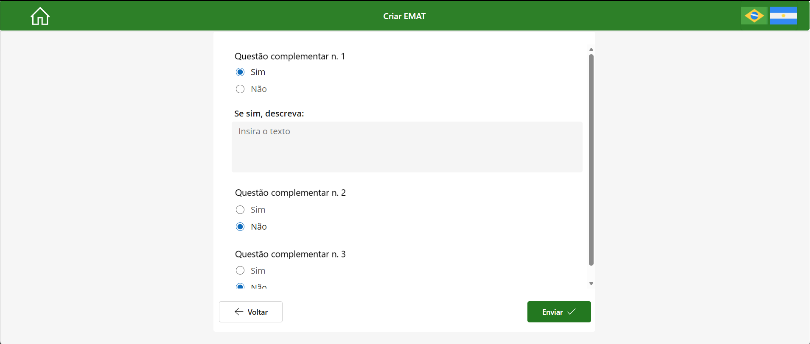
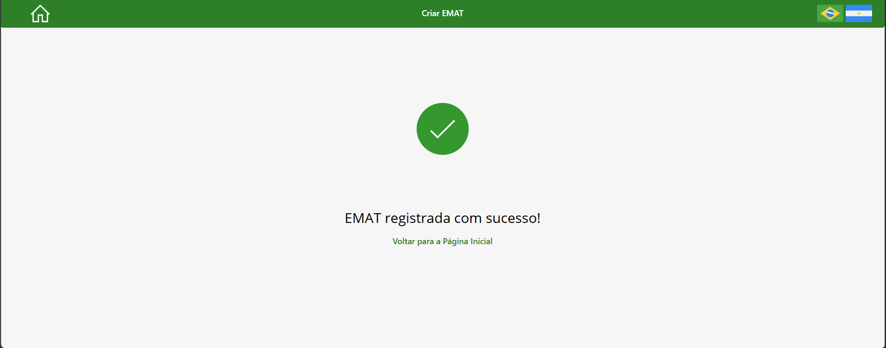

# E-SMAT Application Screenshots

## Overview

This folder presents the main screens of the E-SMAT Power Apps application.

The screenshots illustrate the shared entry point and the two application branches:

- **EMAT**, focused on environmental inspections;
- **SMAT / ESMAT**, focused on safety or integrated safety and environmental inspections.

All visible fields, identifiers, operational references, and records were anonymized before the images were added to the portfolio.

---

## Folder Structure

```text
screenshots/
├── README.md
├── shared/
│   └── 01-home-screen.png
├── emat/
│   ├── 01-inspection-identification.png
│   ├── 02-environmental-questionnaire.png
│   ├── 03-complementary-questions.png
│   └── 04-submission-confirmation.png
└── smat-esmat/
    ├── 01-inspection-identification.png
    ├── 02-dynamic-questionnaire.png
    ├── 03-complementary-questions.png
    └── 04-submission-confirmation.png
```

---

## Shared Entry Point

### Home Screen


The home screen is the shared entry point for E-SMAT and provides two workflow options:

- **Create EMAT**;
- **Create SMAT / ESMAT**.

The application automatically loads the interface in Brazilian Portuguese or Argentine Spanish according to the language configured on the user's device or browser. The language controls in the header allow the user to switch languages manually.

The workflow identities are visually differentiated:

- Green for EMAT;
- Blue for SMAT / ESMAT.

---

## EMAT Workflow

### 1. Inspection Identification


The identification screen collects the information required to establish the environmental inspection context.

The operational location is selected through the following cascading hierarchy:

```text
Site
  ↓
Segment
  ↓
Business Unit / Area
  ↓
Line
  ↓
Workstation
```

The screen also provides controls to clear the entered information, proceed to the questionnaire, return home, and switch the interface language.

### 2. Environmental Questionnaire


The environmental questionnaire displays the requirements associated with the selected operational context.

The screen includes:

- Environmental category;
- Question number;
- Environmental requirement;
- Safe-observation quantity;
- Unsafe-observation quantity;
- Description field;
- Back and Next controls.

The requirements are loaded dynamically from SharePoint reference data according to the selected context, questionnaire version, category, active status, and display order.

### 3. Complementary Questions



The final inspection stage collects complementary information before submission, including:

- Identification of an unsafe condition;
- Description of the condition, when applicable;
- Safety-tag information;
- Near-miss information.

The user can return to the questionnaire or submit the completed inspection.

### 4. Submission Confirmation



The confirmation screen is displayed after the EMAT submission is processed successfully.

The screen confirms the registration and provides an action to return to the application home screen. The submitted inspection is not made available to the inspection user for later editing within E-SMAT.

---

## SMAT / ESMAT Workflow

### 1. Inspection Identification


SMAT and ESMAT share the same identification screen and cascading location hierarchy.

After the required information is validated, the application evaluates the operational context and determines whether the applicable methodology is SMAT or ESMAT. The user does not manually select between the two methodologies.

### 2. Dynamic Questionnaire


The questionnaire displays the requirements associated with the applicable SMAT or ESMAT configuration.

The screen includes:

- Question category;
- Question number;
- Inspection instruction or requirement;
- Safe-observation input;
- Unsafe-observation input;
- Description field;
- Back and Next controls.

Green identifies safe observations, red identifies unsafe observations, and blue remains the primary workflow color.

### 3. Complementary Questions


The complementary stage records unsafe-condition, safety-tag, and near-miss information before final submission.

Information entered during the active inspection session remains available when the user navigates between the questionnaire and this screen.

### 4. Submission Confirmation


The confirmation screen is displayed after the inspection header and question-level responses are processed.

The screen presents a methodology-specific registration message and an action to return to the home screen. Submitted records are not available to the inspection user for post-submission editing within the application.

---

## Complete Visual Flow

```text
Home Screen
      │
      ├── Create EMAT
      │        ↓
      │   Inspection Identification
      │        ↓
      │   Environmental Questionnaire
      │        ↓
      │   Complementary Questions
      │        ↓
      │   Submission Confirmation
      │
      └── Create SMAT / ESMAT
               ↓
          Inspection Identification
               ↓
          Automatic SMAT or ESMAT Routing
               ↓
          Dynamic Questionnaire
               ↓
          Complementary Questions
               ↓
          Submission Confirmation
```

---

## Related Documentation

- [`../app-overview.md`](../app-overview.md): application purpose, scope, methodologies, and main capabilities;
- [`../navigation-logic.md`](../navigation-logic.md): screen sequence, workflow branching, validation, and submission flow;
- [`../cascade-filtering.md`](../cascade-filtering.md): cascading location hierarchy and questionnaire-routing logic;
- [`../localization.md`](../localization.md): automatic language detection and manual language switching;
- [`../state-persistence.md`](../state-persistence.md): in-session state preservation and final SharePoint submission.

---

## Portfolio Scope

The screenshots demonstrate the application interface, bilingual experience, workflow separation, location selection, dynamic questionnaires, complementary questions, and submission confirmation.

The images preserve the functional context of the solution without exposing identifiable users, real operational structures, production connections, or the complete proprietary inspection requirement set.
