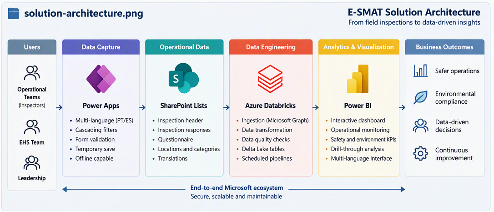
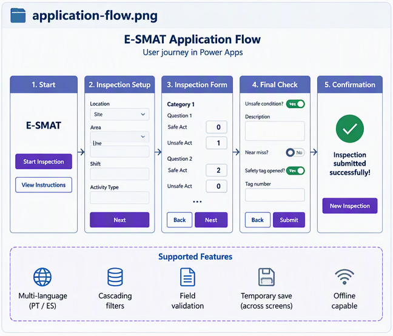
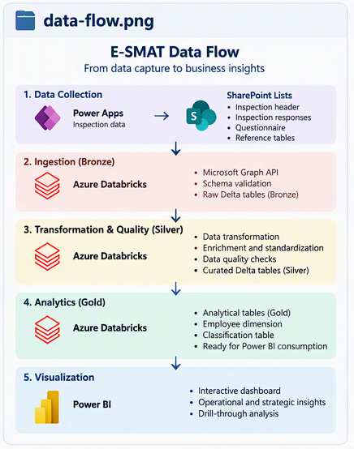

# E-SMAT Architecture

## Overview

This folder contains the high-level diagrams that explain how the E-SMAT solution works across the application, operational-data, data-engineering, and analytics layers.

The diagrams complement the detailed documentation available in `power-apps/`, `data-engineering/`, and `power-bi/`. They provide a concise visual entry point without repeating the implementation details documented in those folders.

> The public architecture uses generalized names and synthetic structures. Production credentials, URLs, environment names, list identifiers, catalogs, schemas, and confidential business data are not represented.

---

## Contents

| File | Purpose |
|---|---|
| `solution-architecture.png` | End-to-end architecture and main technology layers |
| `application-flow.png` | User journey and navigation inside the Power Apps application |
| `data-flow.png` | Movement of inspection data from capture to analytical consumption |

---

## Solution Architecture



The solution architecture shows the complete path from inspection users to analytical outcomes:

```text
Operational teams
        ↓
Power Apps
        ↓
SharePoint Lists
        ↓
Microsoft Graph API
        ↓
Azure Databricks and Delta Lake
        ↓
Power BI
        ↓
Operational and strategic insights
```

### Main layers

- **Users:** operational inspection teams, EHS teams, and leadership;
- **Data capture:** multilingual Power Apps canvas application;
- **Operational data:** SharePoint Lists for headers, responses, questionnaire, locations, categories, and translations;
- **Data engineering:** Microsoft Graph ingestion, PySpark transformations, quality controls, and Delta tables in Azure Databricks;
- **Analytics:** semantic modeling, DAX measures, filters, interactive pages, and drill-through analysis in Power BI;
- **Outcomes:** inspection monitoring, safer operations, environmental compliance, and evidence-based decisions.

---

## Application Flow



The application flow summarizes the inspection journey:

```text
Start
  ↓
Inspection setup
  ↓
Dynamic questionnaire
  ↓
Complementary safety fields
  ↓
Validation and submission
  ↓
Confirmation
```

The application supports:

- Portuguese and Spanish interfaces;
- Cascading operational filters;
- Questionnaire routing by site, methodology, and context;
- Safe and unsafe act quantities;
- Conditional unsafe-condition, Safety Tag, and near-miss fields;
- Temporary session storage across screens;
- Final validation before submission;
- SharePoint persistence.

Detailed application documentation is maintained in:

```text
../power-apps/
```

---

## Data Flow



The data flow documents the analytical lifecycle:

```text
1. Data collection
   Power Apps → SharePoint Lists

2. Ingestion
   Microsoft Graph API → Bronze Delta tables

3. Transformation and quality
   Bronze → Silver → quality gate

4. Analytical publishing
   Quality-approved Silver → Gold Delta tables

5. Visualization
   Gold tables → Power BI semantic model and dashboard
```

### Core pipeline outputs

```text
Bronze
├── inspection_header_bronze
├── inspection_responses_bronze
└── inspection_requirements_bronze

Silver
├── inspection_header_silver
├── inspection_responses_silver
└── inspection_requirements_silver

Quality
├── data_quality_summary
└── data_quality_failures

Gold
├── inspection_header
├── inspection_responses
├── inspection_requirements
└── inspection_classification

Auxiliary
├── employee_dimension
└── inspection_employee_bridge
```

Detailed pipeline documentation is maintained in:

```text
../data-engineering/
```

The public report model, measures, mock data, screenshots, and page documentation are maintained in:

```text
../power-bi/
```

---

## Architecture Principles

The solution follows these principles:

- Clear separation between application, source, engineering, quality, and analytics responsibilities;
- Persisted Bronze, Silver, quality, and Gold boundaries;
- Configuration-driven processing;
- Reusable ingestion and transformation functions;
- Explicit schema and key validation;
- Multilingual normalization;
- Quality checks before analytical publishing;
- Synthetic and anonymized public data;
- Compatibility between the production-inspired model and the public portfolio clone;
- Documentation separated by technical layer to avoid duplication.

---

## Related Documentation

```text
../README.md
../power-apps/README.md
../data-engineering/README.md
../power-bi/README.md
```

- `power-apps/`: application behavior, navigation, cascading filters, localization, and temporary save;
- `data-engineering/`: Graph ingestion, transformations, data quality, Delta publishing, and employee-dimension processing;
- `power-bi/`: semantic model, DAX measures, screenshots, dashboard pages, theme, and synthetic analytical data.
