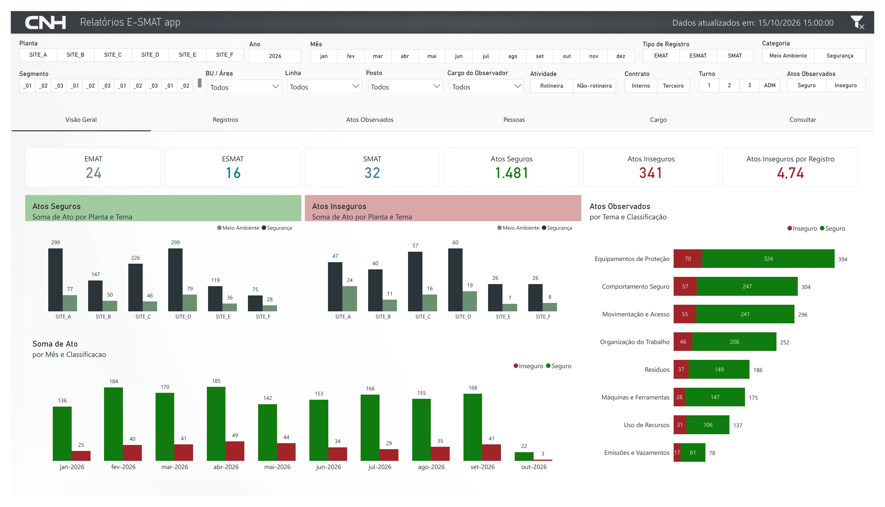
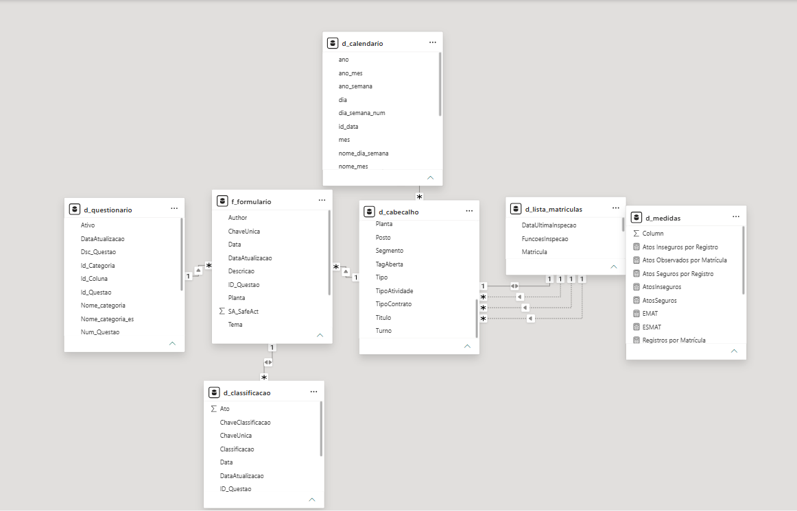

# E-SMAT Power BI Dashboard

## Overview

This folder contains the public Power BI layer of E-SMAT, including the downloadable PBIX, synthetic source tables, semantic-model documentation, DAX measures, report screenshots, and visual theme.

The report consolidates EMAT, SMAT, and ESMAT inspection records into an interactive analytical experience covering inspection volume, safe and unsafe acts, safety and environmental themes, operational hierarchies, observer participation, observed people, job roles, and record-level drill through.

The public report is a clone of the operational dashboard connected only to synthetic data. The implemented model, calculations, navigation, visible pages, and hidden drill-through pages were preserved whenever possible, while production records, employee information, organizational identifiers, and connection details were removed.

> All values displayed by the public report are synthetic. The repository does not contain production inspection records, real employee information, corporate credentials, or confidential organizational structures.

---

## Dashboard Preview



The report contains six visible analytical pages and two hidden drill-through pages:

```text
Visão Geral
Registros
Atos Observados
Pessoas
Cargo
Consultar
DT_Registro
DT_Matricula
```

Detailed page descriptions are available in [`dashboard-pages.md`](dashboard-pages.md).

---

## Power BI File

The portfolio includes the downloadable report:

[`e-smat-dashboard.pbix`](e-smat-dashboard.pbix)

The PBIX is a public-safe clone of the operational dashboard and uses the synthetic files available in `mock-data/`.

The file preserves:

- The implemented semantic model and relationships;
- Power Query transformations;
- DAX measures organized in `d_medidas`;
- Six visible report pages;
- Two hidden drill-through pages;
- Slicers, visual interactions, navigation buttons, and sorting rules;
- The visual identity defined by `theme/esmat-theme.json`.

The PBIX does not contain production credentials, internal connection details, real employee information, or production inspection records.

### Opening the report

1. Download `e-smat-dashboard.pbix`;
2. Download the complete `mock-data/` folder;
3. Keep all mock CSV files together in one local folder;
4. Open the PBIX in Power BI Desktop;
5. If prompted, update the CSV source paths in Power Query to the local `mock-data/` folder;
6. Apply the query changes and refresh the model.

Local paths can differ between computers, so the CSV sources may need to be redirected after download. Expected schemas, table names, keys, data types, and relationships are documented in [`data-model.md`](data-model.md).

The screenshots and Markdown documentation remain available for repository visitors who do not have Power BI Desktop installed.

---

## Power BI Architecture

```text
Synthetic CSV sources
        ↓
Power Query transformations
        ↓
Semantic model
        ↓
DAX measures
        ↓
Visible analytical pages
        ↓
Hidden drill-through pages
```

The principal active filter path is:

```text
d_calendario
      ↓
d_cabecalho
      ↓
f_formulario
      ↓
d_classificacao
```

Additional dimensions provide questionnaire and employee context:

```text
d_questionario → f_formulario
```

```text
d_lista_matriculas → d_cabecalho
```



The complete model documentation is available in [`data-model.md`](data-model.md).

---

## Folder Structure

```text
power-bi/
├── README.md
├── e-smat-dashboard.pbix
├── dashboard-pages.md
├── data-model.md
├── measures.md
├── key-validation-report.md
│
├── mock-data/
│   ├── d_cabecalho.csv
│   ├── f_formulario.csv
│   ├── d_questionario.csv
│   ├── d_classificacao.csv
│   ├── d_calendario.csv
│   └── d_lista_matriculas.csv
│
├── screenshots/
│   ├── README.md
│   ├── 01-overview.png
│   ├── 02-records.png
│   ├── 03-observed-acts.png
│   ├── 04-people.png
│   ├── 05-job-roles.png
│   ├── 06-record-search.png
│   ├── 07-drill-through-record.png
│   ├── 08-drill-through-employee.png
│   └── 09-data-model.png
│
└── theme/
    └── esmat-theme.json
```

---

## Report Pages

| Page | Visibility | Analytical purpose |
|---|---|---|
| **Visão Geral** | Visible | Executive KPIs, themes, site comparisons, and monthly trends |
| **Registros** | Visible | Inspection volume by operational hierarchy and date |
| **Atos Observados** | Visible | Safe and unsafe acts by plant, segment, area, line, and workstation |
| **Pessoas** | Visible | Observer and observed-person analyses |
| **Cargo** | Visible | Indicators by job role and synthetic employee |
| **Consultar** | Visible | Searchable inspection-level detail and navigation |
| **DT_Registro** | Hidden | Complete context and question detail for one inspection |
| **DT_Matricula** | Hidden | Inspection history and observed acts for one selected registration |

The screenshots and visual descriptions are documented in [`dashboard-pages.md`](dashboard-pages.md).

---

## Semantic Model

| Table | Role | Grain |
|---|---|---|
| `d_cabecalho` | Inspection header | One row per inspection |
| `f_formulario` | Question-level fact | One row per inspection and question |
| `d_questionario` | Questionnaire dimension | One row per question context |
| `d_classificacao` | Safe/unsafe classification fact | Two rows per response |
| `d_calendario` | Date dimension | One row per calendar day |
| `d_lista_matriculas` | Employee registration dimension | One row per registration |
| `d_medidas` | DAX measure container | No analytical grain |

### Principal relationships

```text
d_calendario[id_data] 1 ─── * d_cabecalho[Data]
```

```text
d_cabecalho[Titulo] 1 ─── * f_formulario[Titulo]
```

```text
d_questionario[Id_Questao] 1 ─── * f_formulario[ID_Questao]
```

```text
f_formulario[ChaveUnica] 1 ─── * d_classificacao[ChaveUnica]
```

The model preserves `d_cabecalho[Tipo]` as the methodology field for compatibility with the cloned PBIX. Direct downstream date relationships remain inactive when they would create ambiguous filter paths.

See [`data-model.md`](data-model.md) for data types, active and inactive relationships, filter propagation, employee-role handling, and drill-through dependencies.

---

## Measures

The report uses a dedicated `d_medidas` table. Principal measures include:

```text
EMAT
ESMAT
SMAT
AtosSeguros
AtosInseguros
Atos Seguros por Registro
Atos Inseguros por Registro
Atos Observados por Matrícula
Registros por Matrícula
SA ENV
SA SAF
UA ENV
UA SAF
Ultima_Atualizacao
```

Expected unfiltered mock totals:

```text
EMAT                           24
ESMAT                          16
SMAT                           32
Total inspection records       72
Safe acts                   1,481
Unsafe acts                   341
Total acts                  1,822
Unsafe acts per record        4.74
```

Complete DAX definitions and reconciliation rules are documented in [`measures.md`](measures.md).

---

## Mock Data

| File | Rows | Purpose |
|---|---:|---|
| `d_cabecalho.csv` | 72 | Synthetic inspection headers |
| `f_formulario.csv` | 952 | Synthetic question-level responses |
| `d_questionario.csv` | 119 | Synthetic questionnaire metadata |
| `d_classificacao.csv` | 1,904 | Safe and unsafe classification rows |
| `d_calendario.csv` | 365 | Complete 2026 calendar |
| `d_lista_matriculas.csv` | 93 | Synthetic employee registrations and names |

The production dashboard uses governed enterprise sources. These CSV files exist only to make the public portfolio version reviewable without production access.

---

## Key Validation

The synthetic model passed 31 key and relationship controls:

```text
Overall status      PASS
Checks executed       31
Passed                31
Failed                 0
Blocking failures      0
```

The checks confirm unique keys, complete header-detail relationships, valid questionnaire references, two classification rows per response, quantity reconciliation, complete calendar coverage, complete registration coverage, and no orphan relationship keys.

See [`key-validation-report.md`](key-validation-report.md) for the complete result.

---

## Calendar and Employee Analysis

`d_calendario` covers every day from January 1 through December 31, 2026 and supports year, month, period, ISO week, day, quarter, and semester analyses.

`d_lista_matriculas` consolidates registrations from the observer and three observed-person columns. The dimension contains synthetic names and stable sorting fields.

The model also creates `NumeroObservados` in Power Query by counting valid registrations across:

```text
MatriculaObservado
MatriculaObservado2
MatriculaObservado3
```

This column supports normalized measures on the Pessoas and DT_Matricula pages.

---

## Theme and Screenshots

The report theme is stored in:

```text
theme/esmat-theme.json
```

The screenshots folder contains the six visible pages, two hidden drill-through pages, and the semantic-model view. The image inventory is documented in [`screenshots/README.md`](screenshots/README.md).

---

## Compatibility Decisions

The public adaptation preserves:

- Existing table and measure names;
- `d_cabecalho[Tipo]` as the methodology field;
- `Titulo` as the header-to-response key;
- `ChaveUnica` as the response-to-classification key;
- Existing drill-through behavior;
- Existing active and inactive relationships;
- Existing page layouts and visual interactions;
- Existing employee-role logic;
- Existing filters and sort settings.

The mock contains more segment values than the original layout was designed to show. Some labels are truncated, but the underlying values and calculations remain valid. The layout was intentionally not redesigned for the portfolio clone.

---

## Security and Confidentiality

The public Power BI layer excludes:

- Real employee names or registrations;
- Production inspection records;
- Internal plant, area, line, workstation, or segment names;
- Corporate email addresses;
- Production URLs or workspace identifiers;
- Catalog or schema names;
- Credentials, access tokens, or private configuration;
- Confidential questionnaire content;
- Production quality results.

---

## Documentation Map

```text
README.md
├── e-smat-dashboard.pbix
├── dashboard-pages.md
├── data-model.md
├── measures.md
├── key-validation-report.md
└── screenshots/README.md
```

- [`e-smat-dashboard.pbix`](e-smat-dashboard.pbix): downloadable Power BI report connected to synthetic data;
- [`dashboard-pages.md`](dashboard-pages.md): visible and hidden report pages;
- [`data-model.md`](data-model.md): semantic model, relationships, data types, and filter paths;
- [`measures.md`](measures.md): DAX definitions and expected results;
- [`key-validation-report.md`](key-validation-report.md): mock-data integrity checks;
- [`screenshots/README.md`](screenshots/README.md): image inventory.

---

## Portfolio Scope

This folder demonstrates the reporting layer of an end-to-end E-SMAT solution connecting Power Apps, SharePoint, Microsoft Graph API, Databricks, Delta Lake, data-quality controls, and Power BI.

The public implementation highlights semantic-model design, Power Query transformations, DAX measures, date analysis, employee registration analysis, active and inactive relationships, drill-through navigation, visual theming, synthetic-data validation, and public-safe technical documentation.
